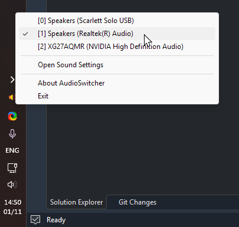

# AudioSwitcher - a simple Win32 utility to help you switch between different audio devices

## Mission statement

Windows supports using multiple output audio devices and therefore, of course, allows you to switch between them at will. There is just one problem though.
Since Windows Vista (or at least I assume so, I only first encountered this functionality in 7) Windows allows you to separately assign a Default Device
and a Default Communication Device. And sometimes, when using the modern device switching UI in the system tray, it will switch your Default Device, but leave
the Default Communication device unchanged, leading to you being very confused as to why you can't hear your friends over Discord, for example. Previously
I'd always use the "Sound" window of the Control Panel to see all my playback devices and change the audio output device there, but starting from Windows 10
Microsoft started replacing the old Control Panel UI with fancier, more modern-looking analogues, and as of Windows 11 you have to really dig through the
settings menu to find that UI again. This would all be well and good if the replacement interfaces provided the same functionality; however, they don't.
The notion of a Communication Device being a thing at all is completely hidden from you as the user in the modern UI, and if you somehow have it set to something
you don't want (maybe you plugged something in/out and things got reset), you won't be able to change it, or even see what it's set to, without bringing up the old
menu.

This annoyed me very much, and so I wrote this little utility to force switching both the default and the communication device at once to whatever I want.
This was performed by using some undocumented Win32 API calls that I discovered while digging through forums somewhere. Upon reading this, you might feel
a little uneasy and concerned regarding the security of this program, to which I say: what is a little googling and undocumented API usage among friends,
in the days of vibecoding and modern AI models being used to write thousands of lines of code with barely any supervision and deploy that code straight
into production? But if you don't trust me, that's completely understandable too! In which case, please do feel free to browse through the code (the program
really isn't all that big) and verify it for yourself.

So far the app has saved me many clicks, and I hope it can do the same for you as well!

## Usage

[You can download the latest release here.](https://github.com/gwtjxyz/AudioSwitcher/releases) If you don't trust me not to put crypto miners or keyloggers
into the .exe, you can build it yourself instead.

Simply open the program and find the little speaker icon in your system tray. It should look something like the image at the top of this Readme, and it should
automatically enumerate and list all the audio devices you have on your PC. Click on the device you want to use, and it'll set that device as both the Default
Device as well as the Default Communication Device. For more granular control, select the "Open Sound Settings" item in the menu and it'll bring up the old
Control Panel sound settings UI.

## Building

I used VS2026 to build this project, probably it can be made to work with older MSVC versions with a little bit of fiddling around. Hopefully you won't have to
adjust any file paths or anything like that.

## Credits

[Speaker icons created by Good Ware - Flaticon](https://www.flaticon.com/free-icons/speaker)
